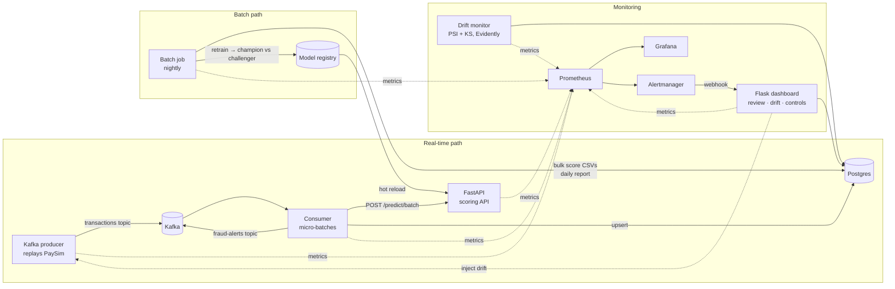

# 🛡️ FraudShield: real-time fraud detection, end to end

A payments platform streams transactions through **Kafka**. Each one is scored for fraud in milliseconds by a
**FastAPI** model service and stored in **Postgres**. Analysts review flagged transactions in a **Flask** dashboard.
A **batch** job does bulk scoring, daily reports and **retraining**. The whole system is watched for **data drift**,
latency and errors with **Prometheus + Grafana + Alertmanager**. Everything is **Dockerised**, started with one
**docker compose** command, tested and shipped by **GitHub Actions**, and deployed to a **free cloud VM**.

**Total cost: $0.**



## How it maps to the curriculum

| # | Session | Where it lives |
|---|---|---|
| 1 | Flask API | `services/dashboard/`: analyst UI, review feedback loop, alert webhook, JSON API, basic auth |
| 2 | FastAPI | `services/api/main.py`: Pydantic validation, `/predict`, `/predict/batch`, `/docs`, hot model reload |
| 3 | Docker | a `Dockerfile` per service: slim base, layer caching, non-root user, healthchecks |
| 4 | Docker Compose | `docker-compose.yml`: 13 containers, healthcheck-based `depends_on`, one-shot trainer, volumes; `docker-compose.prod.yml` adds memory limits |
| 5 | Cloud deployment | `docs/DEPLOYMENT.md` + `deploy/`: Oracle Always Free ARM VM (or Codespaces / Render) |
| 6 | CI/CD with GHA | `.github/workflows/ci.yml`: lint → tests → **full-stack e2e test** → multi-arch images to GHCR. `deploy.yml`: SSH deploy + health check |
| 7 | Streaming with Kafka | `services/producer`, `services/consumer`: keyed messages, idempotent producer, manual commits after the DB write (at-least-once), alerts topic |
| 8 | Real-time vs batch | same model, two paths: ms-latency stream scoring vs `batch_job.py` bulk scoring, daily reports and retraining on a schedule |
| 9 | Monitoring drift | `services/ml/monitor.py` + `common/.../drift.py`: PSI/KS per feature, live precision/recall from delayed labels, Evidently HTML report, **drift injection** to demo it |
| 10 | Logging, monitoring, alerts | JSON structured logs everywhere, Prometheus metrics in every service, provisioned Grafana dashboard, 11 alert rules → Alertmanager → dashboard / Slack / Discord / Telegram |

## The data

[PaySim](https://www.kaggle.com/datasets/ealaxi/paysim1) is a synthetic mobile-money dataset based on real transaction logs:
6.3M transactions, 743 hourly steps (31 days), with a fraud label.

- **Steps 1–400** are history, used for training.
- **Steps 401–743** are "the future", replayed live through Kafka.

The time-based split means no leakage.

**No download needed to start.** If `data/raw/paysim.csv` is missing, the trainer generates a PaySim-like synthetic
dataset with the same schema and fraud patterns. To use the real one:
1. Download it from Kaggle.
2. Rename it to `paysim.csv` and put it in `data/raw/`.
3. Run `make clean && make up`.

**Model:** gradient-boosted trees (`HistGradientBoostingClassifier`, scikit-learn's LightGBM-style algorithm).
- Class weights handle the less-than-1% fraud rate.
- The model uses engineered features, e.g. balance errors, account emptied, merchant destination.
- The decision threshold is tuned on a time-based validation set.
- It's judged on **PR-AUC, precision and recall**. Accuracy is meaningless at 99.9% legit.

## Quick start (local)

You need Docker Desktop (or Docker Engine with Compose 2.24+) and about 6 GB of free RAM.

```bash
cp .env.example .env
make up                 # = docker compose up -d --build   (first build ~3-5 min)
make smoke              # optional: full end-to-end check
```

| URL | What |
|---|---|
| http://localhost:5000 | **Dashboard**: live KPIs, flagged transactions, drift, models, alerts, controls |
| http://localhost:8000/docs | **Scoring API** (try `POST /predict`) |
| http://localhost:3000 | **Grafana**: "FraudShield" dashboard (admin/admin) |
| http://localhost:9090 | Prometheus (`/alerts` shows rule states) |
| http://localhost:9093 | Alertmanager |

No `make`? Use `docker compose up -d --build`. Every Makefile target is a one-line docker command (`make help`).

## 10-minute demo script

1. **Real time:** open the dashboard. Throughput climbs to ~1,200 tx/min and flagged transactions appear.
   In Grafana, *Produced vs scored* and *Latency* show the stream and its latency (API p95 is a few ms).
2. **Feedback loop:** on *Flagged*, mark a few as *Confirmed fraud* or *False alarm*. Retraining uses these labels.
3. **Drift:** go to *Controls* → `amount_inflation` → Apply. Then:
   - Within ~2 minutes, the *Drift* page shows PSI > 0.2 on the money features.
   - Grafana's *Dataset drift* panel turns red.
   - After ~1 more minute, `DataDriftDetected` appears on *Alerts* (and in Discord/Slack/Telegram if configured).
4. **Retraining:** click *Retrain now* (or wait for the batch job). On *Models*, the challenger is evaluated against
   the champion on the most recent holdout. If promoted, the API hot-reloads it with no downtime.
   The drift reference updates, so the alert resolves.
   Switch drift back to `none` afterwards and the monitor flags drift again, because the world changed back. That's realistic.
5. **Batch:** run `make batch-sample && make batch-now`. 50k transactions are scored in one pass into `data/batch/output/`,
   and a daily report is written. Compare that with the per-event latency of the stream.
6. **Ops:** `docker compose stop consumer`. `ConsumerStalled` fires and the end-to-end latency panel spikes.
   Then run `docker compose start consumer`.
7. **CI/CD:** push a commit and watch Actions: tests → e2e stack test → images → deploy to the VM.

## Project structure

```
common/fraudshield_common/   shared library: features, data, drift, model registry, training, logging, db
training/train.py            initial training (offline/batch)
services/
  api/          FastAPI scoring service       (+ Dockerfile.render for the free Render demo)
  dashboard/    Flask analyst UI + alert webhook
  producer/     Kafka producer (stream replay + drift injection)
  consumer/     Kafka consumer (real-time scoring pipeline)
  ml/           monitor.py (drift) · batch_job.py (bulk scoring, reports, retraining)
monitoring/     prometheus (scrape + alert rules) · alertmanager · grafana (provisioned dashboard)
db/init.sql     Postgres schema
tests/          unit + API tests (run without Kafka/Postgres)
scripts/        smoke_test.sh (e2e) · make_batch_sample.py
deploy/         setup_vm.sh (one-time VM setup) · release.sh (pull + restart)
.github/        ci.yml · deploy.yml
docs/           DEPLOYMENT.md
```

## Development

```bash
make setup      # .env + pip install -r requirements-dev.txt
make test       # pytest (features, drift, model, API, dashboard)
make lint       # ruff
make train      # train locally without Docker -> ./models
make logs s=consumer
make psql       # SQL shell:  SELECT count(*), sum(is_fraud_pred::int) FROM predictions;
```

Key design decisions:
- **Training/serving skew avoided**: one `build_features()` is shared by training, the API and the batch job.
- **At-least-once + idempotent**: Kafka offsets are committed only after the Postgres write, and inserts use
  `ON CONFLICT DO NOTHING`, so a crash never loses or duplicates a transaction.
- **Champion/challenger**: a retrained model replaces the current one only if it is at least as good on fresh data.
- **Delayed labels**: the true label travels with the event to simulate chargebacks, but is never a model input.
  It's what makes live precision/recall measurable.
- **Hour-of-day is not drift-monitored**: the stream replays in time order, so any short window covers only a few
  hours and would always look drifted. Monitoring it would only produce false alarms.

## Deploy for free

See **[docs/DEPLOYMENT.md](docs/DEPLOYMENT.md)**. In short:
1. Create an Oracle Always Free ARM VM (2 OCPU / 12 GB).
2. Run `deploy/setup_vm.sh` on it.
3. Add 3 secrets and 1 variable to GitHub.
4. `git push`.

No card? Use Codespaces for the full stack, or Render for a public API link.

## Troubleshooting

| Symptom | Fix |
|---|---|
| `api` stays unhealthy | `docker compose logs trainer`: the first model is still training, or the dataset path is wrong |
| No transactions on the dashboard | `docker compose logs producer consumer`: Kafka can take ~30s to become healthy on first start |
| Out of memory on a small machine | lower `PRODUCER_TPS`, `MAX_LEGIT_TRAIN_ROWS` and `SYNTHETIC_ROWS` in `.env` |
| Want a clean slate | `make clean && make up` (deletes volumes: DB, models, Kafka data) |
| Port already in use | change `API_PORT`, `DASHBOARD_PORT` or `GRAFANA_PORT` in `.env` |
